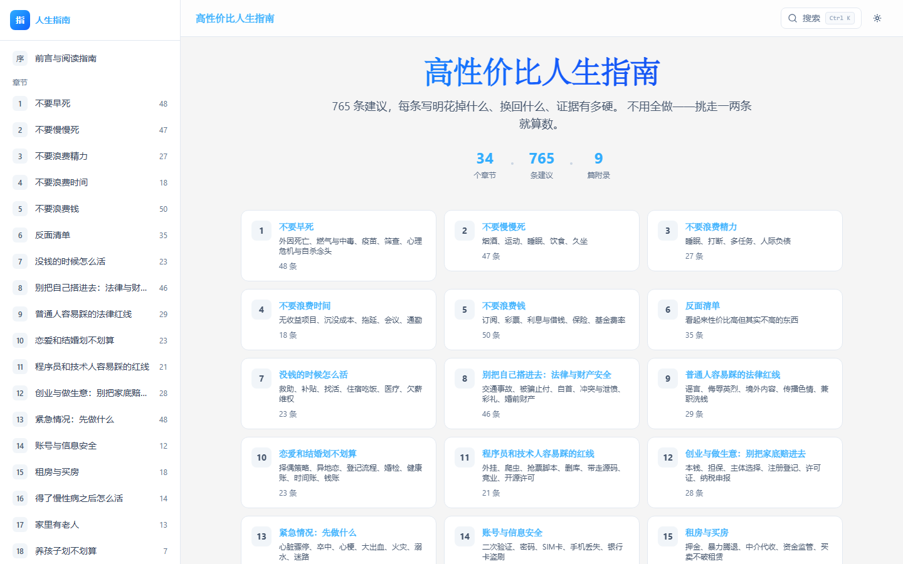

# 高性价比人生指南

**765 条建议，每条写明花掉什么、换回什么、证据有多硬。**

[在线浏览](https://jiaossir.github.io/howtolivebetter-visual/) · [功能特性](#功能特性) · [本地运行](#本地运行) · [技术栈](#技术栈)

<p align="center">
  <a href="https://jiaossir.github.io/howtolivebetter-visual/"></a>
  <a href="https://jiaossir.github.io/howtolivebetter-visual/"></a>
</p>

---

## 功能特性

### 全站模糊搜索

- 快捷键 `Ctrl + K` / `⌘ K` 随时唤起搜索浮层
- 同时搜索章节、具体建议和附录文档段落
- 多关键词 AND 匹配，按字段权重排序，标题命中优先
- 结果中关键词以主题蓝色高亮

### 从结果直达段落

- 点击结果跳转到目标章节的具体条目，URL 形如 `#/chapter/ch01#item-ch01-1`，可直接分享
- 目标卡片自动定位到视口中央并展开详情
- 命中关键词闪烁提示，约 3 秒后自动恢复，不干扰后续阅读

### 证据等级体系

| 等级 | 含义 | 数量 |
| --- | --- | --- |
| A | 有具体数字，出自荟萃分析、大型队列或随机对照试验 | 492 条 |
| B | 有研究支持，但数字不确切或样本有限 | 217 条 |
| C | 作者经验或公认做法，暂无直接研究文献 | 56 条 |

章节页支持按证据等级筛选，快速找到最「硬」的建议。

### 阅读体验

- 浅色 / 深色主题一键切换
- 阅读进度条实时反馈
- 响应式布局，手机、平板、桌面通用
- 尊重 `prefers-reduced-motion`，动画可自动降级

## 内容一览

| | | |
| --- | --- | --- |
| 01 不要早死 | 13 紧急情况：先做什么 | 24 看病：怎么少花钱少走弯路 |
| 02 不要慢慢死 | 14 账号与信息安全 | 25 人走了以后要办什么 |
| 03 不要浪费精力 | 15 租房与买房 | 26 做一个网站或平台 |
| 04 不要浪费时间 | 16 得了慢性病之后怎么活 | 27 怀孕和生产 |
| 05 不要浪费钱 | 17 家里有老人 | 28 别为了外形把身体搞坏 |
| 06 反面清单 | 18 养孩子划不划算 | 29 遭遇重大打击之后 |
| 07 没钱的时候怎么活 | 19 在职、离职和工伤 | 30 上学以后的孩子 |
| 08 别把自己搭进去：法律与财产安全 | 20 刚出生的孩子怎么带 | 31 十八岁之后有哪几条路 |
| 09 普通人容易踩的法律红线 | 21 出国、旅行与境外安全 | 32 出国留学 |
| 10 恋爱和结婚划不划算 | 22 怎么放松：娱乐场所和减压 | 33 残疾之后怎么活 |
| 11 程序员和技术人容易踩的红线 | 23 学什么技能划算 | 34 家里的常备药别吃出事 |
| 12 创业与做生意：别把家底赔进去 | | |

附录共 9 篇，包括结婚成本拆解、家庭应急装备清单、陌生人急救决策、平台资质与服务器选择、夜班与昼夜节律、被裁后先做什么、生育手续时间表、慢性病确诊后安排、换工作换城市清单。

## 本地运行

```bash
npm install
npm run dev        # 开发服务器
npm run test       # 运行测试
npx vite build     # 生产构建
npx vite preview   # 预览构建结果
```

## 技术栈

- **React 19 + TypeScript** —— 组件化页面与严格类型
- **Vite 8** —— 开发与构建
- **Tailwind CSS 4** —— 样式与响应式布局
- **React Router 7** —— HashRouter，静态托管友好
- **Base UI** —— 无障碍搜索浮层
- **Vitest + Testing Library** —— 59 项单元与交互测试
- **GitHub Actions + Pages** —— 推送自动构建部署

## 项目结构

```text
src/
├── components/   # 布局、搜索浮层、建议卡片、阅读进度条等
├── pages/        # 首页、前言、章节页、附录文档页
├── lib/          # 搜索索引、匹配评分与高亮
├── data/         # 34 章建议与 9 篇附录的结构化内容
├── test/         # 测试环境与浏览器 API mock
└── index.css     # 主题变量、动画与全局样式
```

## 部署

站点使用**相对资源路径 + Hash 路由**，同一份构建产物可以同时部署在域名根目录和子路径：

- 在线站点（GitHub Pages）：<https://jiaossir.github.io/howtolivebetter-visual/>
- 推送到 `master` 分支后，GitHub Actions 自动构建并发布
- 也可将 `dist/` 部署到任意静态托管服务

## 说明

- 内容为原书整理与可视化呈现，各条建议均标注原始来源，具体数据以来源原文为准。
- 本站内容仅供学习与信息参考，不构成医疗、法律、投资或税务建议；涉及重大决策请咨询持证专业人士。
